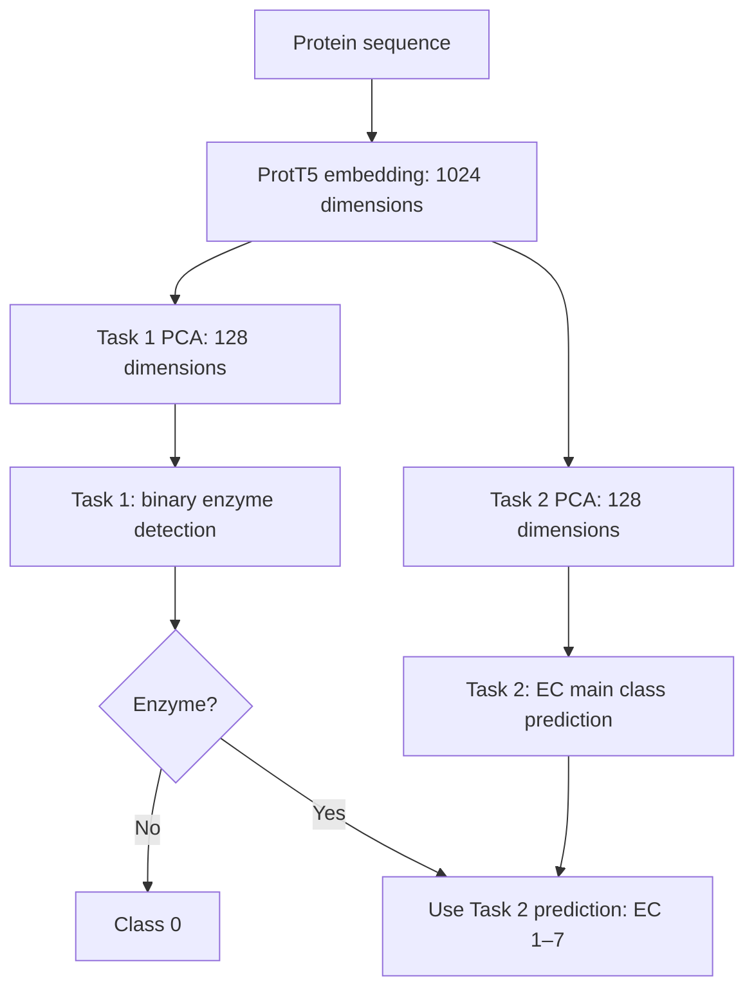

# Enzyme classification with protein language model embeddings

A lightweight, hierarchical machine learning approach to enzyme detection and first-level Enzyme Commission (EC) classification.

**Academic project · Rostlab · Joint B.Sc. Bioinformatics, LMU & TUM**

## Overview

This repository is a curated portfolio version of a collaborative academic machine learning project completed at the Rostlab as part of the joint B.Sc. Bioinformatics program at LMU and TUM. The original development took place in a separate project environment. This repository was subsequently created to document the project's methodology, implementation and results.

The project investigated whether compact feed-forward neural networks could classify proteins effectively using information-rich protein language model embeddings, rather than relying on large task-specific networks.

## Methodology



- **Data preparation:** experimentally annotated UniProt protein sequences; MMseqs2 clustering at a 30% sequence similarity threshold, length filtering and class balancing.
- **Feature extraction:** pretrained ProtT5 protein embeddings, reduced from 1,024 to 128 dimensions with PCA.
- **Task 1:** binary classification using a compact 128–128–64–1 feed-forward network.
- **Task 2:** classification into seven EC main classes using a 128–256–7 network.
- **Task 3:** hierarchical integration of the two classifiers.
- **Model selection:** stratified cross-validation and iterative local experiments for Task 1; Optuna hyperparameter optimization and Weights & Biases tracking for Task 2; comparison against classical baselines.

## Research notebooks and data preparation

The historical preprocessing and feature-comparison notebooks are retained under the respective task directories. See [data preparation and feature engineering](docs/data_preparation.md) for the documented final datasets and [original clustering-threshold results](results/data_analysis/task1_clustering/) for exploratory comparisons. Notebook outputs were cleared and local paths made relative; the notebooks are archival and have not been rerun. Original datasets and embeddings are not distributed.

## Baseline and feature comparisons

The original [feature/classifier search exports](results/feature_comparison/gridsearch_model_comparison/) and [later baseline comparison figures](results/baselines/) document the exploratory path to the compact neural classifiers. Their experimental conditions are not assumed identical; the older ProtT5 RF grid-search export records a higher MCC than the final FNN, and its exact original split is unverified.

## Results

These are results from the original collaborative project, not from a new run of the portfolio code.

| Task | Evaluation dataset | Metric | Result |
|---|---|---|---:|
| Binary enzyme detection | Internal test set (5,901 proteins) | MCC | **0.82** |
| EC main class prediction | Internal test set (1,178 enzymes) | Macro-F1 | **0.74** |
| EC main class prediction | Independent Price-149 benchmark | Weighted F1 | **0.72** |

The original project report documents the experimental methodology, baseline comparisons and limitations. Selected original test outputs for Tasks 1 and 2 are included in [results/](results/).

## Repository layout

```text
task_1/src/       Binary classifier and research utilities
task_2/src/       Multiclass classifier and research utilities
task_3/src/       Portable hierarchical model adapter
configs/         Selected original model configurations
task_1/notebooks/ Historical preprocessing and feature/classifier comparisons
task_2/notebooks/ Historical preprocessing and Random Forest baseline
results/         Selected original experimental and test results
docs/            Research methodology and archival notes
scripts/         Synthetic model-interface smoke test
```

## Getting started

For the model-interface demonstration, use Python 3.11 or 3.12 in a clean virtual environment from the repository root:

```bash
python -m venv .venv
source .venv/bin/activate
python -m pip install -r requirements.txt
python -m scripts.smoke_test
```

The smoke test uses randomly initialized models, synthetic embeddings and synthetic PCA transforms. It checks model interfaces only; it does not reproduce the reported classification scores. This portfolio adaptation has not yet been executed end to end.

The selected research modules are available for code review. Their broader dependencies are listed in `requirements-research.txt`, which reflects the original environment plus additional imports. Full reproduction requires the original sequence datasets, clustering outputs, embeddings, fitted PCA transforms and model checkpoints, which are not distributed here. The historical training and preprocessing utilities have not been fully revalidated in a clean environment.

## Implementation notes and limitations

- Task 3 was adapted to accept trained classifiers and fitted PCA transformers explicitly instead of loading files from machine-specific paths.
- The original Task 1 and Task 2 network implementations and saved configurations are retained. The saved Task 2 configuration records AdamW with learning rate 0.001, and the implementation includes a final sigmoid. The report describes a learning rate of 0.01 and a linear output layer. These historical discrepancies are recorded rather than silently changing the experiment.
- Predictions are limited to the first EC level and a single label per protein. This is a research prototype, not a production annotation system.
- Large datasets, raw embeddings, model checkpoints and most intermediate logs are excluded. Selected archival research notebooks are included; they have not been rerun.

## Authors and contributions

This project was developed collaboratively by Neo Mehmedinovic, Luis Telaak, David H. Nar and Daniel Poock. The models, evaluation and results are a team achievement.

Luis's project work included dataset preparation, neural network architecture development and experiment tracking with Weights & Biases.

This repository documents the shared academic work; the portfolio-specific documentation and portability changes are separate from the original experiments.
