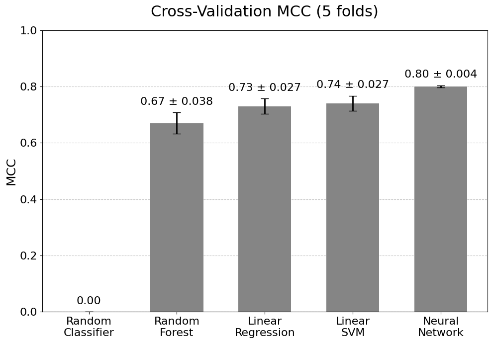
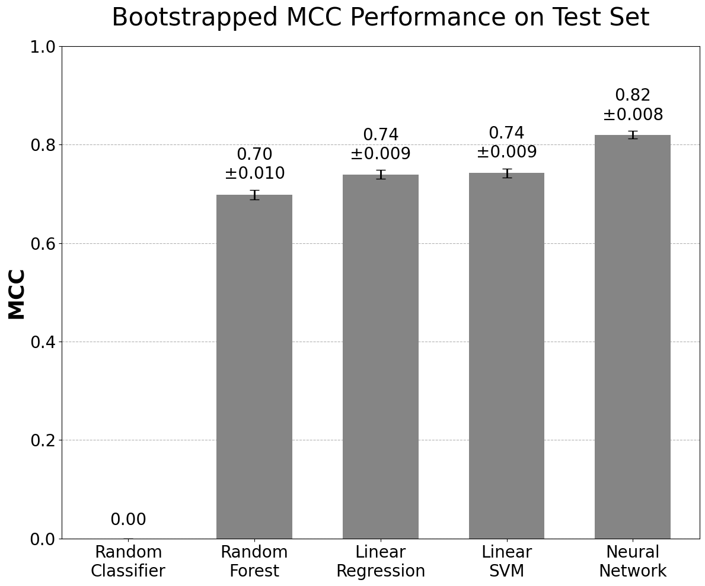

# Historical baseline comparisons

## Task 1: binary enzyme classification

The original [ProtT5 notebook](../../task_1/notebooks/gs_comp_prott5.ipynb) contains the default Random Forest, Logistic Regression, LinearSVC and DummyClassifier comparisons on the named c30, 2–98 percentile, 128-dimensional dataset and saved figures comparing them with the neural network. The following values are transcribed from the original plotting cells (original zero-based indices 8 and 29); they are rounded historical reporting values, not newly computed metrics. The notebook has exploratory cells and repeated executions, and not every plotted aggregate is independently traceable to a complete saved fold log.

| Classifier | CV MCC | CV error bar | Test MCC | Bootstrap error bar |
|---|---:|---:|---:|---:|
| Dummy / random (plot label) | 0.00 | 0 | 0.00 | 0 |
| Random Forest | 0.67 | 0.038 | 0.698 | 0.010 |
| Logistic Regression | 0.73 | 0.027 | 0.739 | 0.009 |
| Linear SVC | 0.74 | 0.027 | 0.742 | 0.009 |
| Feed-forward neural network | 0.80 | 0.004 | 0.82 | 0.0078 |

Original PNG outputs were extracted without redrawing. The figure's label "Linear Regression" refers to the LogisticRegression estimator in the notebook. The notebook contains actual baseline fitting/prediction cells and a dummy test MCC of zero, as well as a bootstrap loop for SVC. The separate historical `Dummyclassifier.py` was deliberately excluded: it generates random labels and hardcodes other classifier scores, so it is not evidence of a fair fitted baseline comparison. The exact final FNN test metrics are in [the saved test output](../task1_test_metrics.txt).

The [grid-search exports](../feature_comparison/gridsearch_model_comparison/) are a separate historical experiment collection and include a higher ProtT5 RF score; their exact original split/protocol is not verified. Do not combine the two comparisons as if they were one controlled experiment.

## Task 2: EC classification

The [random forest notebook](../../task_2/notebooks/task2_random_forest.ipynb) uses balanced class weights and five-fold cross-validation. It tracks balanced accuracy, macro-F1 and MCC. The [two saved plots](task2/) come from that experiment. The training input is labelled as a split without undersampling. The notebook also records an optional W&B file upload for a different, undersampled dataset.

Figure 9 of the final report compares the classifiers on the 1,178-enzyme test set across 1,000 bootstrap samples. The text in section 3.2.2 identifies the “Linear Regression” bar as logistic regression.

| Classifier | Macro-F1 | Bootstrap standard deviation |
|---|---:|---:|
| Dummy classifier | 0.06 | 0.002 |
| Random forest | 0.44 | 0.022 |
| Logistic regression | 0.58 | 0.020 |
| Linear SVC | 0.60 | 0.019 |
| Task 2 neural network | 0.74 | 0.016 |

The [Task 2 test record](../task2/#held-out-test-verification) gives the unrounded network score and identifies the available test data.
