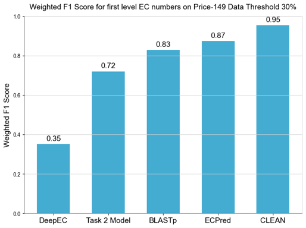

# External EC benchmark · Price-149

The team evaluated Task2Model on 149 experimentally characterized bacterial proteins at the first EC level. Section 4.3 of the final project report, *Prediction of enzymatic activity*, reports both macro-F1 and weighted F1 of 0.72. Macro-F1 weights each class equally, while weighted F1 weights it by its number of examples. Figure 11 compares weighted F1 across methods. The [CSV](scores.csv) transcribes the reported figures at their published precision.

The report describes removing training sequences above 30% identity to Price-149. The original `task_2/notebooks/benchmark_performance.ipynb` (Git blob `3e0fcfd213235566e053cf0894d7fd1ba6ef6789`) shows a subsequent check on an already-filtered file that retained all 6,581 sequences in that file. Slide 19 reports the same size for the filtered development set, compared with 6,672 for the internal Task 2 split. Its saved inference attempt stopped during embedding generation. The original repository also contains weights and training curves for a separately trained Price-filtered model. No linked per-sequence predictions or completed metric output establish the precise checkpoint used for the reported score. The comparison values for the other methods are taken from the report figure.

The local Price table contains 149 distinct sequences. The final talk also records macro-recall of 0.75 and MCC of 0.65 for Price-149. These are presentation values.
