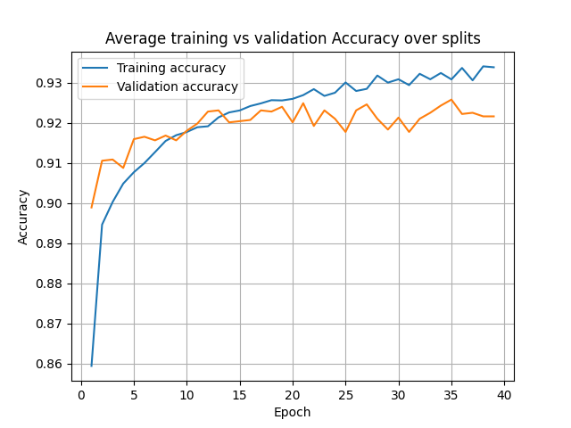
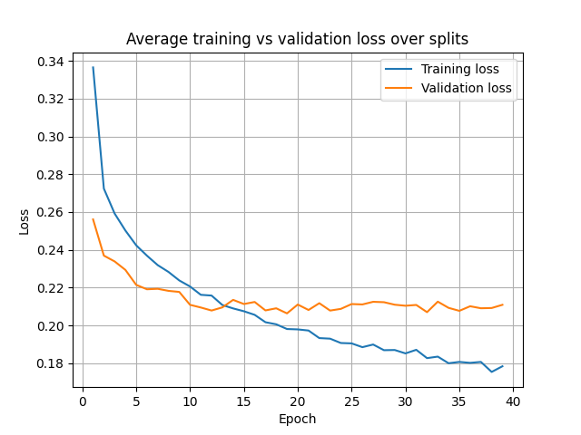
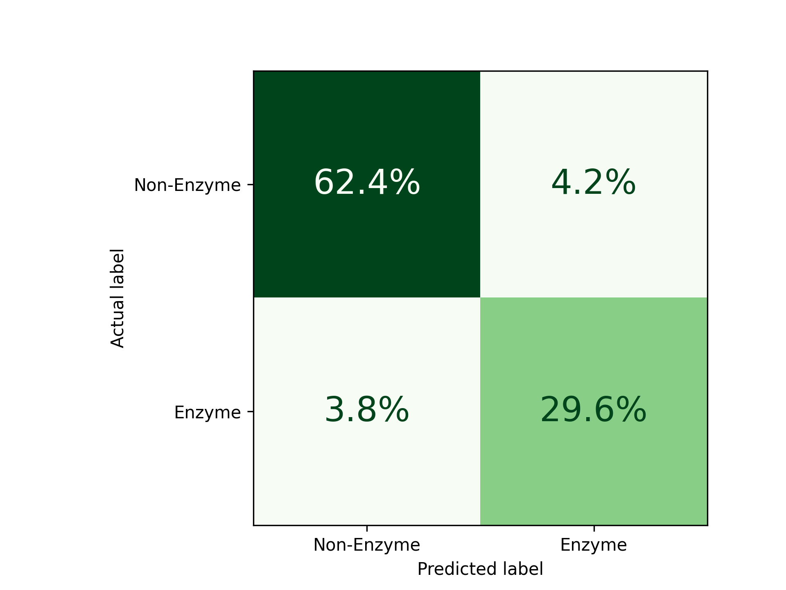

# Task 1: final binary classifier

The checkpoint reproduced the archived test accuracy, MCC and confusion matrix on all 5,901 proteins when evaluated with the original 128-dimensional test embeddings.

- [Model selection and original CV archive](model_selection/)
- [Final model configuration](../../configs/task1.yaml)
- [Original checkpoint](../../checkpoints/task1.pth)
- [Original held-out test metrics](../task1_test_metrics.txt)

| Metric | Recorded value |
|---|---:|
| Test accuracy | 0.9198440942213184 |
| Test MCC | 0.8203024040584289 |
| Reported AUC | 0.9114342058752395 |

The AUC in the original inference code is calculated from rounded class predictions, not continuous scores. The training code uses early stopping on a 90/10 development split. It records `best_model_state = model.state_dict()` without a deep copy and saves weights before the final restoration call. Therefore the exact relationship between the saved checkpoint and the best validation epoch cannot be established from the code alone; the checkpoint nevertheless reproduces the recorded test predictions at the level of the confusion matrix.

The reconstructed Task 1 PCA is included in
[checkpoints/pca](../../checkpoints/pca/).
It was recovered from matching raw and projected training embeddings.

On all 5,901 historical test proteins, the reconstructed transformation
achieves an RMSE of 2.5323e-09 against the stored projected embeddings
and produces identical classifier predictions.

The original datasets are preserved privately.
