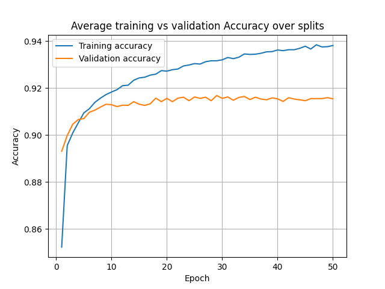
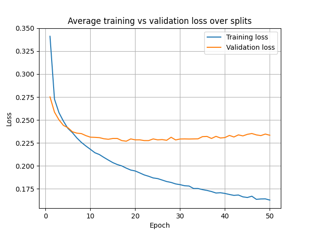

# Task 1 model selection

The original project investigated compact feed-forward models iteratively, using local configurations, logs and stratified five-fold CV rather than the Task 2 Optuna/W&B workflow.

## Earlier experiments

- [AAindex NN notebook](../../../task_1/notebooks/nn_comp_aaindex.ipynb) uses 553-dimensional features and an earlier c100, length-filtered, undersampled dataset. The notebook's last configuration is 553–512–369–128–1, LeakyReLU, dropout 0.5/0.2, Adam at 0.0001, BCE and 200 epochs.
- [Early experiments](early_experiments/) contains both original v1 CSVs and all 16 v2 AAindex configuration files; example run 15 includes original accuracy, loss and MCC plots. Its recorded test MCC is 0.6751. This is not a controlled comparison with the final dataset.
- [Original early file manifest](early_experiments/original_file_manifest.csv) inventories the complete original collection, including plots not copied.

## Local cross-validation archive

All 147 original configuration YAML files and all 132 available metric YAML files are retained unchanged, under [crossval_runs/](crossval_runs/) and [run_131/](run_131/). Fifteen run directories lack a metrics file; missing results are not inferred. Some original filenames differ from their enclosing run folder; both are preserved. [Run inventory](run_inventory.csv) lists every original run and its available files. [Full source manifest](original_file_manifest.csv) lists original paths, blob hashes and sizes for all 682 files. Only run 131's full training log and CV plots are copied from this collection.

For a compact CSV view of configurations and metrics, from the repository root run:

```bash
python scripts/summarize_task1_runs.py > task1_runs_summary.csv
```

The script read all 147 run folders without a parsing error and derived mean fold MCC from the confusion counts for the 132 runs with metrics. Historical data conditions vary across runs; do not rank them globally without checking the dataset and evaluation protocol.

## Run 131 and final configuration

The original `task_1/main.py` explicitly references run 131 for a later training call. Its configuration matches the saved final model architecture, dropout, activation and optimizer settings. This is strong evidence of a relevant model-selection run, not proof that it was the best of every experiment.

| Parameter | Run 131 | Final training |
|---|---|---|
| Dimensions | 128–128–64–1 | 128–128–64–1 |
| Dropout | 0.5 / 0.3 | 0.5 / 0.3 |
| Activation | LeakyReLU | LeakyReLU |
| Optimizer | Adam | Adam |
| Learning rate | 0.001 | 0.001 |
| Weight decay | 0.00025 | 0.00025 |
| Loss | BCE | BCE |
| Maximum epochs | 50 | 100 |

Run 131 recorded mean validation accuracy 0.91542. The final dataset contained 33,434 development proteins and 5,901 held-out test proteins.





The historical [model_selection.py](../../../task_1/model_selection.py) and [main.py](../../../task_1/main.py) are retained with local paths adapted; the latter now loads the original checkpoint from the curated location for its evaluation call. The evaluation in `main.py` reproduced the saved test confusion matrix with the original embeddings. The historical training and cross-validation runs require their datasets and were not repeated. See [final results](../README.md).
