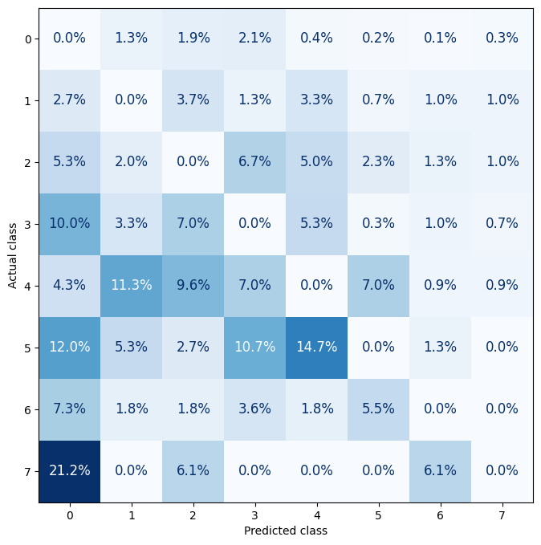

# Hierarchical classification

The [Task 3 model](../../task_3/src/models.py) applies the two fitted PCA transforms to each ProtT5 embedding. When the binary model's rounded output is zero, the pipeline returns class 0. For a predicted enzyme it returns the second model's highest-scoring EC class (1–7). Both classifiers reuse the trained weights from Tasks 1 and 2.

The original evaluation combined non-enzymes from the Task 1 test set with enzymes from the Task 2 test set. Section 2.4.1 of the team's final report gives 4,191 sequences and describes filtering enzymes against the Task 1 training set at 30% identity. The saved notebook assembles the prepared inputs and does not repeat the homology check. The [recorded macro-F1](metrics.csv) averages the eight classes equally. The saved notebook output is 0.6953260225627327. Per-protein predictions and the fitted PCA objects are unavailable in this archive.

Rows are normalized by true class. The plotting cell sets the diagonal to zero to highlight errors. Diagonal zeros do not represent class recall. Source: original Task 3 test notebook, Git blob `dcdd1740ed365b2ad73d17299a82ddc00cbe9331`, cells 7–8 (zero-based).
